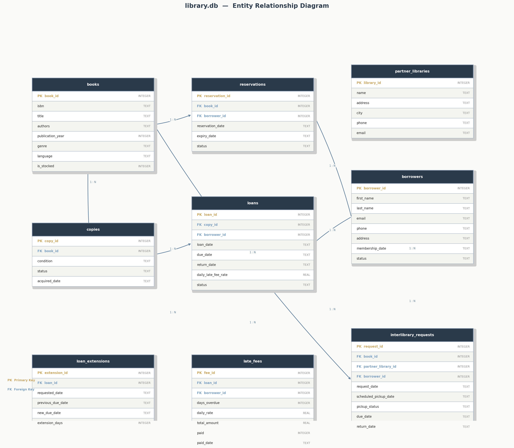
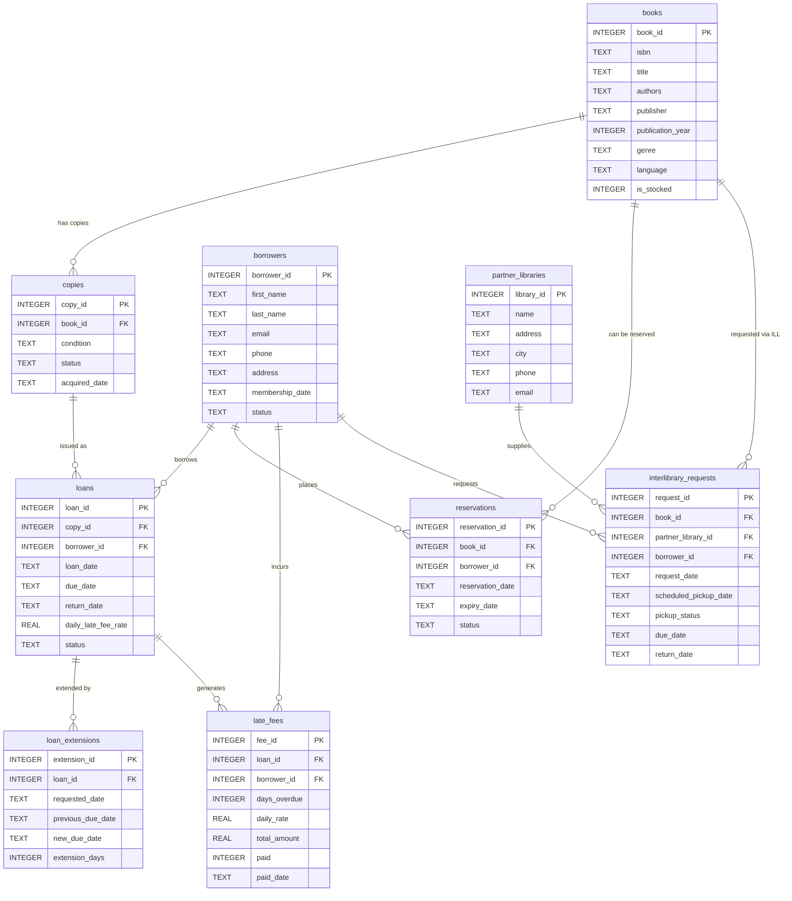

# library.db — Schema Summary

**MSAI-5523 | Module 2 Assignment**

## Written Summary

I built this database to manage a small public lending library. The library needs to track which books it owns, who borrows them, whether a copy is available or checked out, and what happens when someone returns a book late or wants a title that is already out.

**What each table represents**

The `books` table is the library's catalog. It holds one row per title, not one row per physical copy. That distinction matters because a popular title might have five copies on the shelf, and I needed to track each one separately. That is what the `copies` table does. Every row in `copies` is a specific physical book linked to a title in `books`, with its own condition (good, fair, or poor) and its own status (available, on loan, reserved, lost, or withdrawn).

The `borrowers` table stores library members. Each member has contact information, a membership date, and an account status that can be set to suspended if needed.

The `loans` table is where an actual borrowing transaction lives. When a copy is handed to a borrower, a row is created in `loans` with the copy, the borrower, the loan date, the due date, and the late fee rate locked in at that moment. The `loan_extensions` table stores each time a borrower extends their due date, so the full history of changes to that loan is preserved rather than just the final due date.

The `reservations` table handles the case where a title is out of stock. A borrower can place a hold, and the reservation expires after seven days if they do not claim it. The expiry date is stored directly in the row so queries stay simple.

The `late_fees` table records what a borrower owes when they return a book late. It stores the number of days overdue, the rate per day, and the computed total, along with whether the fee has been paid and when.

The `partner_libraries` table holds contact information for nearby libraries that participate in interlibrary lending. The `interlibrary_requests` table connects a borrower, a book, and one of those partner libraries, and tracks the full pickup workflow from the initial request through transit, pickup, and return.

**Relationships**

Most relationships in this database are one-to-many. One book can have many copies. One copy can be loaned out many times over its life. One borrower can have many loans, many reservations, and many late fees. One loan can have many extensions. One partner library can fulfill many interlibrary requests. The database keeps track of all of these by storing the parent table's primary key as a foreign key in the child table.

There are no dedicated many-to-many junction tables, but two tables come close. `loans` sits between `copies` and `borrowers`, and `reservations` sits between `books` and `borrowers`. In both cases the relationship carries enough extra data, such as dates, status, and fee rates, that the table is a real entity in its own right rather than a simple bridge.

**One design decision**

I separated `books` from `copies` from the start, and that turned out to be the most important structural choice. If I had stored everything in one table, I would have had to duplicate the title, author, and publication year for every physical copy on the shelf. I also would not be able to track which specific copy was loaned out, which matters when one copy is in poor condition and another is fine. Splitting the two tables keeps catalog data in one place and inventory data in another.

**One thing I got wrong**

Authors. The `books` table stores authors as a single text field, for example "J.K. Rowling, Mary GrandPré." That works for displaying a name, but it breaks for any real query. If I wanted to find every book by J.K. Rowling I would need a string search, which is fragile and slow on a large catalog. The correct design would be a separate `authors` table and a junction table named something like `book_authors` that links books to authors in a proper many-to-many relationship. I took the shortcut because the source CSV stored authors that way, but it is a real limitation I would fix before putting this database into production.

## Entity Relationship Diagram (Mermaid source)

## Tables

| Table | Rows | Purpose |
|---|---|---|
| `books` | 25 | Title catalog, including ILL-only titles |
| `copies` | 11 | Physical copies owned by this library |
| `borrowers` | 6 | Library members |
| `loans` | 11 | Issued books, active and historical |
| `loan_extensions` | 0 | Per-extension audit trail |
| `reservations` | 0 | Holds placed when a title is out of stock |
| `late_fees` | 1 | Overdue charges tracked through to payment |
| `partner_libraries` | 0 | Nearby libraries available for ILL |
| `interlibrary_requests` | 0 | ILL orders with pickup scheduling |
